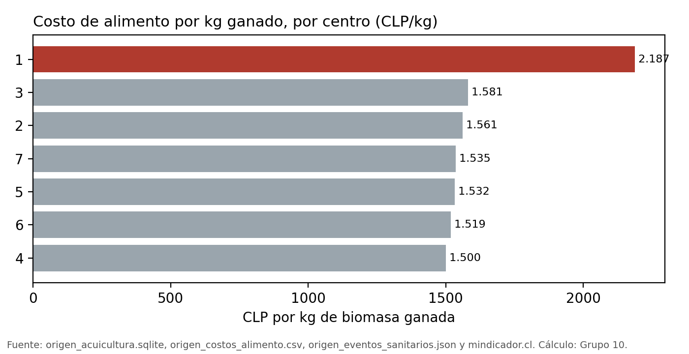
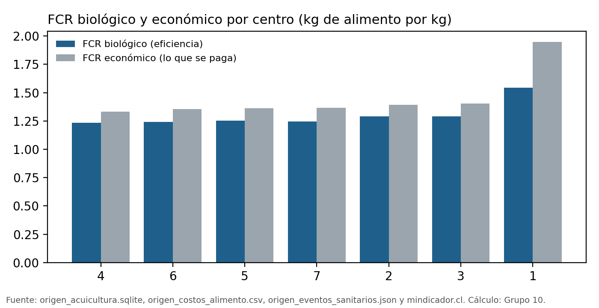
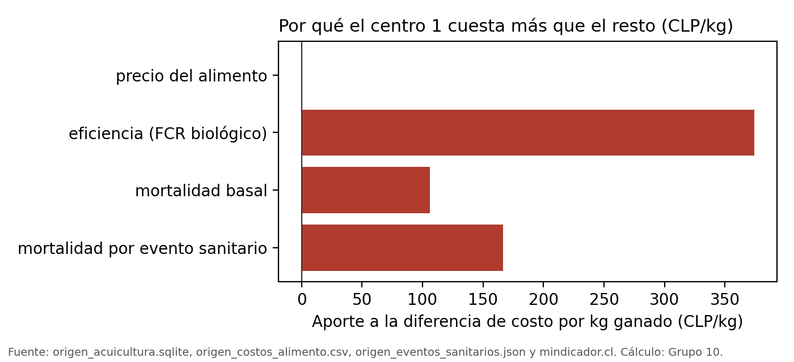
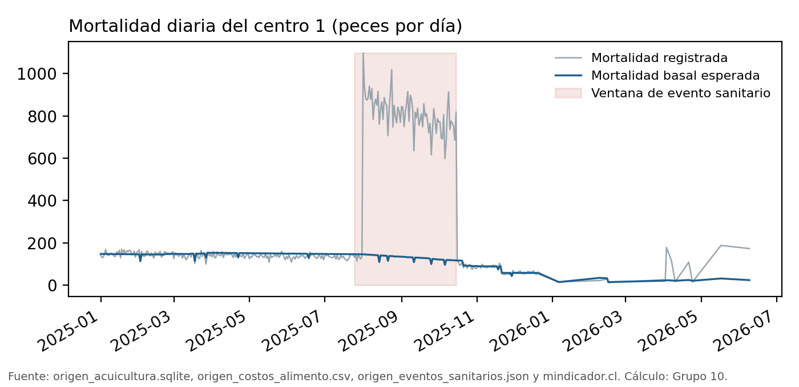
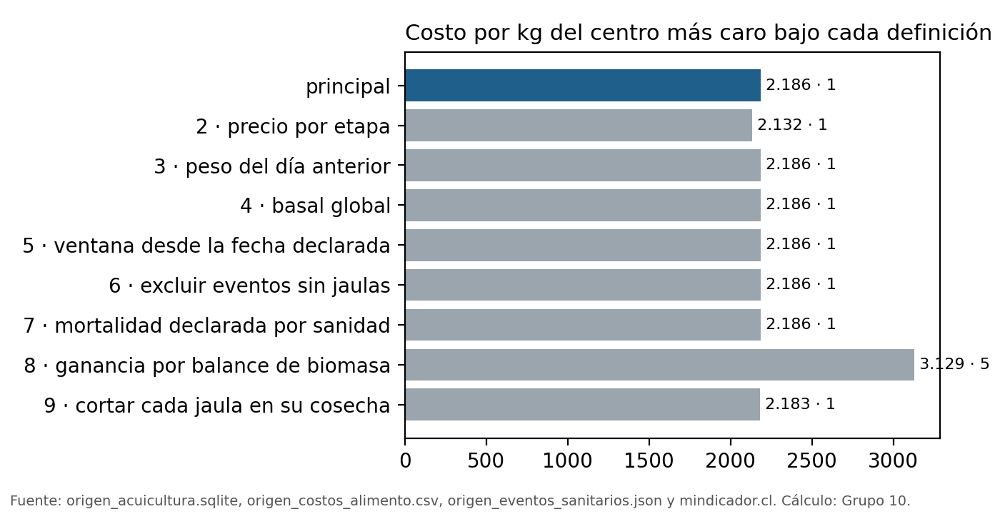

## E. Evidencia y recomendación
# Imagen 1

**Costo de alimento por kg ganado, por centro (CLP/kg)**

# Imagen 2

**FCR biológico y económico por centro (kg de alimento por kg)**

# Imagen 3

**Por qué el centro 1 cuesta más que el resto (CLP/kg)**

# Imagen 4

**Mortalidad diaria del centro 1 (peces por día)**

# Imagen 5

**Costo por kg del centro más caro bajo cada definición (CLP/kg)**

---

### Recomendación a la gerencia

El Centro 1 presenta el mayor costo de producción de la operación, como se observa en la imagen 1, alcanzando los 2.186,5 CLP por kilo ganado, muy por encima del promedio del resto de los centros (1.540 CLP/kg aprox). Al separar las causas de esta brecha, la evidencia demuestra que el problema es predominantemente operativo antes que sanitario (imagen 3). Un 57,9% del sobrecosto frente al resto se explica por ineficiencia pura en la conversión alimenticia en el agua, evidenciada por un FCR biológico deficiente de 1,54 (imagen 2). El evento sanitario es la segunda causa en importancia, aportando un 25,8% de la diferencia del costo total. 

Traducido a impacto financiero, la combinación de mala conversión y enfermedades elevó drásticamente el FCR económico del Centro 1 a 1,94 (los kilos que efectivamente terminó pagando la empresa por kilo que llegó a cosecha). Al aislar estrictamente la biomasa perdida por el brote, el exceso de mortalidad provocado por la detección tardía de la enfermedad representó una pérdida neta de $218.006.017 CLP en este centro, producto exclusivo del alimento consumido por peces que superaron nuestra línea base de mortalidad esperada y no llegaron a proceso.

Recomendamos una intervención inmediata con dos focos para el Centro 1. Primero, auditar exhaustivamente las prácticas y estrategias de alimentación, ya que la ineficiencia biológica (FCR) demostró ser el mayor destructor de margen. Segundo, ajustar los protocolos de sanidad para reducir el desfase de detección reactiva ante brotes, dado que los días de rezago costaron más de 218 millones de pesos. El análisis de sensibilidad confirma que, independientemente del supuesto utilizado para costear el alimento, el Centro 1 se mantiene de forma robusta como el foco principal de pérdidas financieras (imagen 5).

### Cobertura de datos
El **0,99%** de los registros fueron excluidos del cálculo debido a inconsistencias de origen (filas nulas o corruptas), garantizando que las cifras presentadas se apoyan exclusivamente en datos íntegros y verificables.