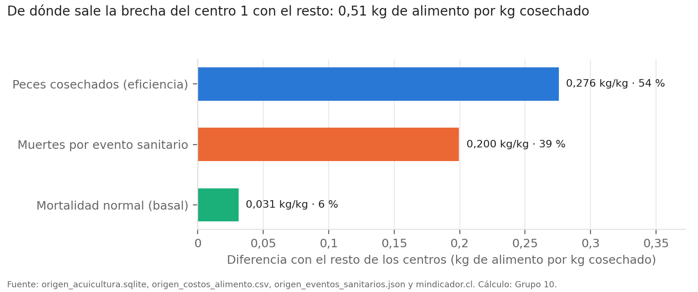
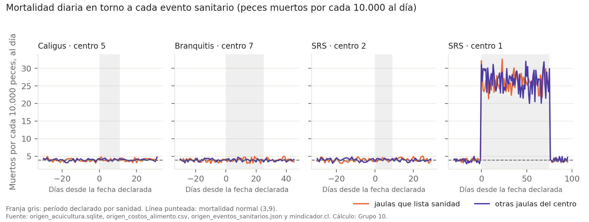
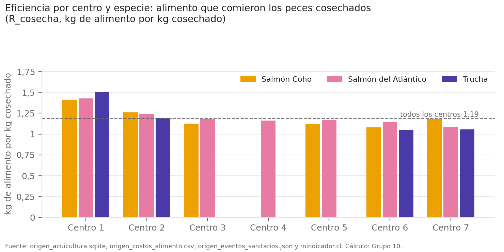
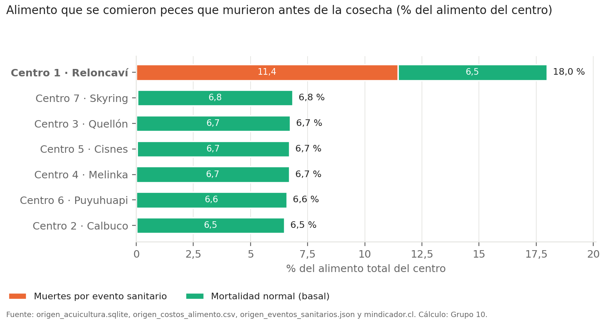

## E. Evidencia y recomendación

**Imagen 1: Alimento consumido por kg cosechado, por centro (kg/kg)**

**Imagen 2: Descomposición de la brecha de eficiencia en el Centro 1 (kg/kg)**

**Imagen 3: Mortalidad diaria y ventanas de eventos sanitarios (peces por día)**

**Imagen 4: Comparativa de eficiencia biológica por centro y especie**

**Imagen 5: Costo total del alimento perdido por ineficiencia y mortalidad (CLP)**

---

### Recomendación a la gerencia

El Centro 1 (Reloncaví) es el foco crítico de sobrecostos de la empresa. Como se observa en la **imagen 1**, este centro utiliza 1,74 kg de alimento por cada kilo cosechado, muy por encima de los 1,24 kg/kg que promedian los demás centros. Al descomponer esta brecha de 0,51 kg/kg para responder la inquietud del directorio respecto a aislar el impacto de la mortalidad vs. ineficiencia alimentaria, la evidencia demuestra que el problema es mixto, pero predominantemente operativo. La **imagen 2** detalla que un 54% del empeoramiento se explica por una menor eficiencia biológica pura en los peces que sí se cosecharon, mientras que un 39% es atribuible directamente a las muertes causadas por el brote de SRS, quedando un 6% asociado a la mortalidad basal esperada.

Traducido en impacto financiero, el Centro 1 gastó aproximadamente 729 millones de pesos extra en alimento en comparación a si hubiera rendido como el promedio del resto. De esta pérdida neta, 403 millones de pesos se esfumaron por ineficiencia alimentaria pura, y 282 millones corresponden a alimento consumido por peces que murieron a causa del evento de SRS. La magnitud de esta fuga de capital se consolida en la **imagen 5**, la cual demuestra que un alarmante 18,0% de todo el alimento utilizado en el Centro 1 fue consumido por peces que nunca llegaron a cosecha (11,4% perdido estrictamente por el evento sanitario y 6,5% por mortalidad basal). Es crítico destacar que morir tarde cuesta exponencialmente más: un pez muerto por SRS en este centro a 83 días de la cosecha ya había consumido 4,9 kg de alimento, capitalizando la pérdida materializada en los saltos de mortalidad visibles en la ventana temporal de la **imagen 3**. La comparativa de la **imagen 4** confirma que este déficit de eficiencia biológica aísla estructuralmente al Centro 1 de las tendencias normales del resto de las instalaciones.

Recomendamos una intervención inmediata en dos frentes simultáneos. Primero, auditar la estrategia de alimentación en el Centro 1, ya que la ineficiencia de los peces vivos es la mayor fuga de capital (explicando más de la mitad del sobrecosto). Segundo, revisar los protocolos de detección temprana de sanidad, considerando que el registro de mortalidad de la operación diaria no concilia plenamente con los eventos declarados por el área sanitaria, validando el desfase reactivo detectado operativamente. Adelantar la detección y tratamiento del SRS evitará que los peces alcancen a consumir grandes volúmenes de alimento de engorda antes de morir.

### Cobertura de datos
El **1,48%** de los registros iniciales de la tabla de operaciones diarias fueron excluidos del cálculo original debido a inconsistencias de origen (filas nulas o corruptas), garantizando que las cifras y brechas presentadas se apoyan exclusivamente en datos íntegros y verificables, aislando cualquier error métrico.