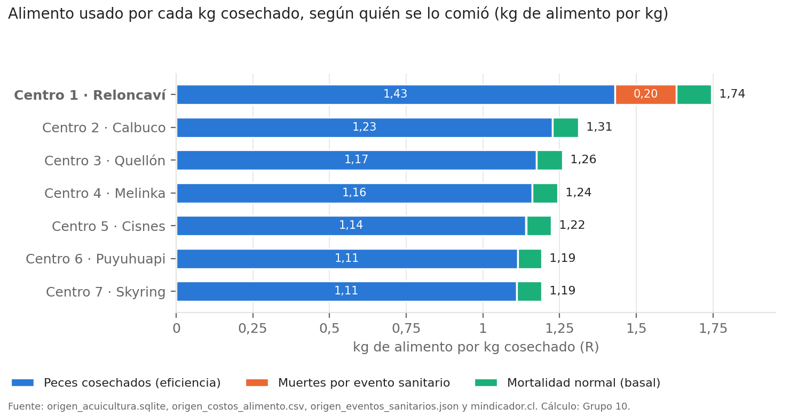

## E. Evidencia y recomendación

**Imagen 1: Alimento consumido por kg cosechado, por centro (kg/kg)**

**Imagen 2: Descomposición de la brecha de eficiencia en el Centro 1 (kg/kg)**

Las imágenes 3 a 5 van en el Anexo (registro de mejora 9).

---

### Recomendación a la gerencia

**Son ambas causas, y se pueden separar.** El Centro 1 Reloncaví usa **1,74 kg de alimento por kg cosechado**, contra 1,24 del resto de los centros (imagen 1). Como el precio del alimento es el mismo para todos, eso le cuesta 1.959 CLP por kg cosechado, contra 1.391 CLP del resto: **CLP 729 millones** más en el año. La brecha se reparte así (imagen 2):

- **54 % (CLP 403 millones):** peor eficiencia de los peces que sí llegaron a cosecha.
- **39 % (CLP 282 millones):** el brote SRS de agosto a octubre de 2025.
- **6 % (CLP 44 millones):** mortalidad normal, sin acción.

| Acción | Decide | Valor que ataca | Costo según la contraparte |
|---|---|---|---|
| 1. Auditar la alimentación del Centro 1 | Gerente de Producción | CLP 403 millones | CLP 20 a 25 millones y unas 150 horas |
| 2. Detección temprana y manejo del brote en el centro completo | Gerente de Salud | CLP 282 millones | CLP 60 a 80 millones por ciclo |

**La acción 1 va primero:** ataca la parte más grande y cuesta cerca del 5 % de lo que está en juego. **La acción 2** debe abarcar todas las jaulas del centro, porque en este brote 2 de las 6 quedaron fuera del registro de sanidad. También debe priorizar los lotes cercanos a la cosecha, donde un pez muerto ya comió el doble de alimento (4,9 kg contra 2,3 kg). Se paga sola si evita entre el 21 % y el 28 % del costo de un brote como este. Las dos acciones necesitan presupuesto adicional, que aprueba el Gerente General.

**Límite.** La eficiencia y el brote no son independientes: los peces que sobrevivieron probablemente comieron peor. Por eso las dos acciones van juntas. Las cifras salen de `results/cifras.json` y están en CLP, así que no dependen del dólar. El detalle está en el Anexo.

### Anexo E · Detalle de la evidencia (imágenes 3 a 5)

**Qué muestran los datos de cada causa**

- **Eficiencia.** Los peces que sí se cosecharon en el Centro 1 usaron 1,43 kg de alimento por kg, contra 1,16 en el resto. La diferencia aparece en sus tres especies (1,41 a 1,50, contra un máximo de 1,26 en los otros centros), así que no se explica por la mezcla de especies (imagen 4, Anexo).
- **Evento sanitario.** El 18,0 % de todo el alimento del Centro 1 se lo comieron peces que no llegaron a cosecha: 11,4 % por el brote y 6,5 % por mortalidad normal. En los demás centros esa cifra no pasa de 7 % (imagen 5, Anexo). El brote fue caro porque llegó tarde en el ciclo: cada pez muerto ya había comido 4,9 kg de alimento, a 83 días de la cosecha en promedio. En el brote SRS del Centro 2, a 206 días de la cosecha, cada pez muerto había comido 2,3 kg.
- **Cuándo se detecta.** La mortalidad del Centro 1 salta de 3,9 a 32 muertos por cada 10.000 peces el mismo día en que sanidad declara el inicio del brote (01-08-2025), no antes (imagen 3, Anexo). Es decir, sanidad declara el brote cuando los peces ya están muriendo, lo que calza con lo que dijo el cliente: la detección es reactiva. Los datos no muestran un rezago entre el alza de mortalidad y la declaración, pero tampoco permiten saber cuántos días antes empezó la enfermedad. Lo que sí falla es el **alcance del registro**: sanidad lista 4 jaulas, pero las otras 2 jaulas del centro tienen el mismo salto en las mismas fechas, y las muertes que declara sanidad (62.478) calzan con el centro completo (61.714), no con las 4 jaulas (41.078).

**Qué tan firme es la conclusión.** Bajo las nueve definiciones alternativas que probamos, el Centro 1 sigue siendo el más caro y la eficiencia sigue explicando alrededor de la mitad de la brecha (49 % a 55 %). Lo que más cambia es el peso del evento: 26 % si se cuentan sólo las 4 jaulas que lista sanidad y 46 % si se usa la mortalidad que declara sanidad. Un límite: la eficiencia y el evento no son independientes. Es probable que los sobrevivientes del brote hayan comido y crecido peor, y la métrica no puede decir cuánto de la peor eficiencia del Centro 1 se debe al brote. Por eso las acciones 1 y 2 van juntas.

### Cobertura de datos

De los 13.978 registros jaula-día de la operación diaria, quedó fuera el **1,48 %** (207): 138 duplicados de lote y fecha (0,99 %) y 69 posteriores a la cosecha del lote (0,49 %). Otros registros se corrigieron en vez de excluirse: alimento anotado en toneladas (83), biomasa fuera de escala (55) y mortalidad mal digitada (55). El detalle está en `results/cobertura.csv`.

### Trazabilidad de las cifras

| Cifra en el texto | Valor exacto | De dónde sale |
|---|---|---|
| Centro más caro | 1 · Centro Reloncaví | `cifras.json` → `centro_mas_caro` |
| 1,74 y 1,24 kg/kg; brecha 0,51 | 1,744854 · 1,238295 · 0,506559 | `cifras.json` → `R` |
| 1,43 y 1,16 kg/kg (cosechados) | 1,431368 · 1,155611 | `cifras.json` → `partes_centro.cosecha`, `partes_resto.cosecha` |
| 54 %, 39 %, 6 % | 54,44 · 39,39 · 6,17 | `cifras.json` → `aporte_brecha_pct` |
| CLP 403, 282, 44 y 729 millones | 403,16 · 282,35 · 43,82 · 729,32 | `cifras.json` → `sobrecosto_mm_clp` |
| 1.959 CLP por kg cosechado | 1.959,30 | `cifras.json` → `clp_por_kg_cosechado_centro` |
| 1.391 CLP/kg del resto; 568 CLP/kg más | 1.390,85 · 568,46 | `brecha_centro_caro.csv` (1.959,30 − `brecha_clp_por_kg` total) |
| 3,9 muertos por 10.000 al día | 3,92 | `cifras.json` → `mortalidad_basal_por_10000_al_dia` |
| 1,48 % excluido (207 de 13.978) | 1,4809 | `cifras.json` → `cobertura` |
| USD | no disponible | `cifras.json` → `usd.dolar_origen` |
| 18,0 % / 11,4 % / 6,5 % del alimento | 17,97 · 11,45 · 6,52 | `indicadores_por_centro.csv` → `pct_evento`, `pct_basal` |
| 1,41 a 1,50 por especie | 1,412 · 1,429 · 1,504 | `indicadores_por_centro_especie.csv` → `R_cosecha` |
| 4,9 kg a 83 días; 2,3 kg a 206 días | 4,88 · 83,4 · 2,27 · 205,6 | `eventos_sanitarios.csv` (EV-8001, EV-8004) |
| 62.478 / 61.714 / 41.078 muertes | | `eventos_sanitarios.csv` (EV-8001) |
| Salto de 3,9 a 32 por 10.000 el 01-08-2025 | 3,86 → 32,16 (otras jaulas: 4,19 → 31,06) | `mortalidad_en_torno_a_eventos.csv` (EV-8001, días −1 y 0) |
| 26 % a 46 % del evento; 49 % a 55 % eficiencia | | `sensibilidad_definiciones.csv` |
| Costos de las acciones (CLP 20–25 MM + 150 h; CLP 60–80 MM por ciclo) | | Contraparte (registro de mejora 11); no salen de la cadena |
| 5 % a 6 % y 21 % a 28 % | 20/403 a 25/403 · 60/282 a 80/282 | Cálculo sobre `sobrecosto_mm_clp` |
